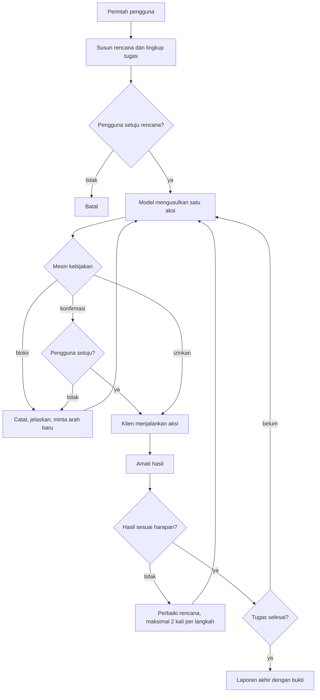
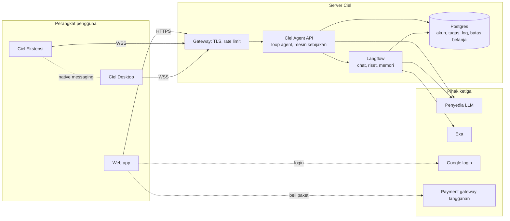

# Arsitektur Ciel AI Agent

Status: draf untuk ditinjau pemilik. Tanggal: 14 November 2026.
Arsitektur chatbot yang sekarang ada di `docs/ARCHITECTURE.md` dan tidak diubah oleh dokumen ini. Dokumen ini menambahkan lapisan agent di sebelahnya.

Keputusan D1 (stack desktop), D2 (penyedia LLM agent), D6 (hosting), dan D10 (urutan rilis) dijawab pemilik pada 14 November 2026 mengikuti rekomendasi. Catatannya di [decisions.md](decisions.md). Perbandingan opsinya tetap ada di bagian 3, 5, dan 7.

## 1. Prinsip

1. Model mengusulkan, kode yang memutuskan. Model tidak pernah memegang kendali langsung atas laptop atau browser. Setiap aksi lewat mesin kebijakan yang ditulis sebagai kode biasa dan bisa dites. Ini lanjutan dari cara Ciel sekarang: model hanya menulis teks, aplikasi yang menggambar dan memeriksa.
2. Otak di server, tangan di perangkat. Loop agent dan mesin kebijakan utama ada di server. Aplikasi desktop dan ekstensi hanya menjalankan aksi yang sudah disetujui, dan tetap memeriksa izin lokal sebelum menjalankannya.
3. Gagal berarti berhenti. Kalau status toko tidak bisa dipastikan, koneksi putus, atau hasil aksi tidak cocok dengan yang diharapkan, agent berhenti dan melapor.
4. Isi dari luar adalah data. Teks halaman web, deskripsi produk, ulasan, email, dan file tidak pernah diperlakukan sebagai perintah.
5. Teks dulu, gambar belakangan. Agent membaca struktur halaman (DOM) atau struktur aplikasi (accessibility tree, yaitu daftar tombol dan kolom yang disediakan sistem operasi untuk pembaca layar). Tangkapan layar hanya dipakai kalau struktur itu tidak ada, karena lebih mahal dan lebih banyak membawa data pribadi.

## 2. Loop agent

Aturan loop:

- Rencana dibuat sekali di awal dan ditunjukkan ke pengguna. Dari rencana itu mesin kebijakan menurunkan lingkup tugas: situs, aplikasi, folder, jenis aksi, dan batas belanja yang boleh dipakai. Model tidak bisa melebarkan lingkup di tengah jalan. Pelebaran lingkup butuh persetujuan pengguna.
- Satu aksi per putaran. Setelah setiap aksi, agent mengamati hasilnya (membaca ulang halaman atau struktur aplikasi) dan membandingkannya dengan yang diharapkan.
- Batas langkah per tugas: 40 aksi (usulan). Batas waktu: 15 menit (usulan). Lewat dari itu agent berhenti dan melapor.
- Tombol stop diperiksa sebelum setiap aksi, di klien dan di server.
- Dua mode otonomi. "Tanya dulu" (bawaan): setiap aksi yang mengubah sesuatu menunggu persetujuan. "Jalan sendiri": aksi R0 dan R1 di dalam lingkup tugas langsung jalan, R2 tetap menunggu konfirmasi, R3 tetap diblokir.
- Laporan akhir memuat apa yang berubah, di mana, dan apa yang gagal atau tidak bisa dipastikan.

## 3. Tools, memori, dan model

### Daftar tools

Setiap tool punya skema argumen yang ketat. Argumen yang tidak cocok skema ditolak sebelum sampai ke klien.

| Kelompok | Tool | Risiko bawaan | Dijalankan di |
|---|---|---|---|
| Umum | `search` (Exa, sudah ada), `memory_search`, `calculator` | R0 | server |
| Umum | `ask_user` (minta klarifikasi), `finish` (laporan akhir) | R0 | server |
| Umum | `memory_store` (hanya dari pesan pengguna sendiri) | R1 | server |
| Browser | `tab_read` (teks dan struktur halaman yang sudah dibersihkan) | R0 | ekstensi |
| Browser | `tab_open`, `tab_close`, `tab_scroll` | R1 | ekstensi |
| Browser | `tab_click`, `tab_type`, `tab_select` | R1, naik ke R2 kalau memicu kirim data | ekstensi |
| Browser | `form_submit` | R2 | ekstensi |
| Belanja | `store_verify` (verifikator dari kode, bukan model) | R0 | ekstensi dan server |
| Belanja | `cart_add`, `cart_read` | R1 | ekstensi |
| Belanja | `checkout_prepare` (menghasilkan ringkasan pembelian) | R1 | ekstensi dan server |
| Belanja | `checkout_handoff` (menyerahkan ke pengguna untuk bayar) | R2 | ekstensi |
| Desktop | `file_list`, `file_read` (folder yang diizinkan) | R0 | desktop |
| Desktop | `file_write`, `file_move`, `folder_create` | R1 | desktop |
| Desktop | `file_delete` (selalu ke Recycle Bin atau Trash) | R2 | desktop |
| Desktop | `app_open`, `ui_read`, `ui_click`, `ui_type`, `key_press` (aplikasi yang diizinkan) | R1, naik ke R2 untuk kirim, pasang, atau ubah pengaturan | desktop |
| Desktop | `screen_capture` (jendela yang diizinkan saja) | R0, tidak disimpan | desktop |

Yang sengaja tidak ada: tool untuk menjalankan perintah terminal, tool untuk mengetik kata sandi atau nomor kartu, tool untuk mengunduh lalu menjalankan file, dan tool pembayaran. Tingkat risiko dijelaskan di [security.md](security.md) bagian 2.

### Memori

| Jenis | Isi | Disimpan di | Umur |
|---|---|---|---|
| Memori jangka panjang | Preferensi dan konteks pengguna (sudah ada) | Vector store per akun di server | Sampai dihapus pengguna |
| Keadaan tugas | Rencana, lingkup, langkah ke berapa | Tabel `agent_tasks` | 90 hari (usulan) |
| Log aktivitas | Setiap aksi, keputusan kebijakan, hasil | Tabel `agent_actions` | 90 hari (usulan) |
| Konteks kerja | Isi halaman dan tangkapan layar yang sedang diproses | Memori proses saja | Hilang saat tugas selesai |

Memori jangka panjang hanya ditulis dari pesan pengguna sendiri, tidak pernah dari isi halaman atau file. Aturan ini sudah berlaku di prompt Ciel sekarang dan dipertahankan.

### Pemilihan model (keputusan D2)

Kebutuhan agent berbeda dari chat. Isi halaman dan layar pengguna jauh lebih sensitif daripada pertanyaan riset, jadi kebijakan data penyedia ikut menentukan.

Harga per 1 juta token, dicek 14 November 2026:

| Model | Input | Output | Kebijakan data | Catatan |
|---|---|---|---|---|
| `deepseek-flash` (dipakai Ciel sekarang) | US$0,15 di luar jam sibuk, US$0,30 jam sibuk | US$0,60 atau US$1,20 | Data disimpan di Tiongkok dan bisa dipakai melatih model kecuali opt-out (`docs/LEGAL.md`) | Bisa membaca gambar. Sumber: halaman harga resmi DeepSeek |
| `gemini-3.5-flash-lite` (cadangan Ciel sekarang) | US$0,30 [PERLU DICEK di halaman resmi] | US$2,50 [PERLU DICEK] | Paket berbayar tidak dipakai melatih, ada DPA (`docs/LEGAL.md`) | Angka dari situs agregator. Ada kabar model ini berstatus lama [PERLU DICEK] |
| `claude-haiku-5-5` | US$0,10 | US$0,50 | [PERLU DICEK: syarat data API komersial Anthropic] | Harga untuk prompt sampai 100 ribu token |
| `claude-sonnet-5-5` | US$2,00 | US$10,00 | [PERLU DICEK] | Punya tool computer use resmi (`computer_toolset_20260801`) |
| `claude-opus-5-5` | US$4,00 | US$20,00 | [PERLU DICEK] | Punya tool computer use resmi |
| Model computer use dari OpenAI dan Google | [PERLU DICEK] | [PERLU DICEK] | [PERLU DICEK] | Belum berhasil diverifikasi dari sumber resmi |

Perkiraan biaya satu tugas. Asumsi: 15 langkah, rata-rata 8.000 token input per langkah (struktur halaman yang sudah diringkas ditambah riwayat), 300 token output per langkah, tanpa cache. Totalnya 120.000 token input dan 4.500 token output.

| Model | Rumus | Biaya per tugas |
|---|---|---|
| `claude-haiku-5-5` | 0,12 × 0,10 + 0,0045 × 0,50 | sekitar US$0,014 |
| `deepseek-flash` jam sibuk | 0,12 × 0,30 + 0,0045 × 1,20 | sekitar US$0,041 |
| `gemini-3.5-flash-lite` | 0,12 × 0,30 + 0,0045 × 2,50 | sekitar US$0,047 |
| `claude-sonnet-5-5` | 0,12 × 2,00 + 0,0045 × 10,00 | sekitar US$0,285 |
| `claude-opus-5-5` | 0,12 × 4,00 + 0,0045 × 20,00 | sekitar US$0,57 |

Tugas yang memakai tangkapan layar menghabiskan token lebih banyak. Besarnya belum diukur dan harus diuji sebelum harga paket dikunci.

Opsi:

| Opsi | Isi | Kelebihan | Kekurangan |
|---|---|---|---|
| A. Dipisah menurut kepekaan data (rekomendasi) | Chat tetap seperti sekarang. Agent memakai penyedia dengan komitmen tanpa pelatihan dan DPA: model murah untuk langkah teks, model computer use hanya untuk langkah yang butuh gambar | Isi layar pengguna tidak masuk ke penyedia yang melatih dari data. Biaya per tugas rendah karena sebagian besar langkah berbasis teks | Menambah satu vendor dan satu DPA. Perlu uji kualitas model murah untuk tugas agent |
| B. Semua di DeepSeek | Agent memakai `deepseek-flash` seperti chat | Tidak ada vendor baru, sudah dikenal | Isi halaman dan layar pengguna dikirim ke penyedia yang bisa melatih dari data, kecuali opt-out sudah dikonfirmasi tertulis. Tidak ada tool computer use resmi |
| C. Semua di Gemini | Agent memakai kunci Gemini berbayar yang sudah ada | DPA sudah berlaku, tidak ada vendor baru | Harga dan status model harus dicek ulang. Tool computer use belum diverifikasi |

Rekomendasi: A. Kriteria yang dipakai berurutan: kebijakan data, harga, lalu ketersediaan tool computer use. Sebelum dikunci, cek tiga hal yang masih bertanda [PERLU DICEK]: syarat data Anthropic, apakah `claude-haiku-5-5` mendukung tool yang dibutuhkan, dan harga resmi Gemini. Apa pun pilihannya, model utama selalu punya cadangan seperti pola `Ciel Fallback Model` sekarang.

## 4. Ekstensi browser

Target pertama: Chrome dan browser berbasis Chromium, Manifest V3.

| Bagian | Tugas |
|---|---|
| Side panel | Tampilan utama: rencana, aksi berjalan, konfirmasi, log, tombol stop |
| Service worker | Menjaga koneksi ke Ciel Agent API, menerima aksi, memeriksa izin lokal, meneruskan ke content script |
| Content script | Membaca struktur halaman, menjalankan klik dan ketik, membaca label toko. Disuntikkan hanya ke tab yang sedang dipakai tugas |
| Adapter toko | Satu modul kecil per marketplace yang tahu letak label resmi dan elemen keranjang. Ikut di dalam paket ekstensi |

Izin yang diminta: `sidePanel`, `storage`, `scripting`, `activeTab`, dan izin situs yang diminta satu per satu saat dibutuhkan (`optional_host_permissions`). Ekstensi tidak meminta akses ke semua situs, tidak meminta riwayat browsing, dan tidak memakai izin `debugger`. Menurut aturan Chrome Web Store, izin `debugger` memicu peninjauan manual, dan ekstensi yang meminta izin lebih dari kebutuhannya bisa ditolak.

Tidak ada kode yang diunduh saat berjalan. Server hanya mengirim data aksi (JSON yang dicek skemanya), dan semua logika ada di paket ekstensi. Ini syarat Manifest V3.

Yang dibaca dari halaman: teks yang terlihat, label kolom, tombol, dan tautan, masing-masing dengan nomor rujukan. Kolom kata sandi, kolom kartu, dan kolom bertanda `autocomplete` pembayaran tidak pernah dibaca atau diisi. Isi halaman dikirim ke server sebagai data bertanda "tidak tepercaya".

Checkout di toko resmi dijelaskan di [security.md](security.md) bagian 4.

## 5. Aplikasi desktop (keputusan D1)

Fungsi: mengelola file di folder yang diizinkan, membuka dan mengoperasikan aplikasi yang diizinkan lewat accessibility tree, dan kontrol keyboard dan mouse sebagai jalan terakhir.

| Opsi | Kelebihan | Kekurangan | Biaya |
|---|---|---|---|
| A. Tauri 2 (inti Rust, tampilan memakai webview bawaan sistem) (rekomendasi) | Installer kecil dan hemat RAM, penting karena laptop pemilik 8 GB. Setiap perintah dari tampilan ke inti harus didaftarkan dulu, jadi permukaan serangan sempit. Pembaruan wajib bertanda tangan. Tampilan bisa memakai React dan TypeScript seperti `website/` | Bagian kontrol sistem ditulis di Rust, perlu belajar. Tampilan bisa sedikit berbeda antara Windows dan macOS karena webview-nya berbeda | Gratis. Biaya hanya sertifikat (lihat bawah) |
| B. Electron (Node.js dan Chromium dibundel) | Ekosistem paling matang, semua ditulis di TypeScript, banyak contoh | Installer besar dan boros RAM. Permukaan serangan lebih lebar, perlu disiplin konfigurasi keamanan | Gratis. Biaya sertifikat sama |
| C. Python (misalnya PySide dengan PyInstaller) | Memakai bahasa yang sudah dipakai repo | Paket hasil PyInstaller sering dicurigai antivirus. Pembaruan otomatis dan tanda tangan harus dirakit sendiri | Gratis. Biaya sertifikat sama |

Biaya dan hambatan yang sama untuk semua opsi:

- macOS: keanggotaan Apple Developer Program US$99 per tahun, dan butuh Mac untuk build serta notarisasi (pemeriksaan otomatis oleh Apple sebelum aplikasi boleh dijalankan). Aplikasi yang mengontrol aplikasi lain tidak bisa hidup di dalam sandbox Mac App Store, jadi distribusinya lewat unduhan langsung dengan Developer ID.
- Windows: layanan tanda tangan termurah dari Microsoft (Azure Artifact Signing, sekitar US$9,99 per bulan) hanya menerima developer individu dari Amerika Serikat dan Kanada. Jalur lain: sertifikat dari otoritas sertifikat [PERLU DICEK harga dan syarat untuk individu], atau distribusi lewat Microsoft Store [PERLU DICEK: apakah aplikasi kontrol desktop diterima, dan akun individu menurut Microsoft tidak untuk kegiatan usaha]. Tanpa tanda tangan, Windows menampilkan peringatan SmartScreen. Untuk aplikasi yang mengontrol laptop, rilis tanpa tanda tangan tidak disarankan.

Rekomendasi: A, dimulai dari Windows saja. Hambatan sertifikat Windows adalah alasan utama ekstensi dirilis lebih dulu (D10).

Cara kontrol, dari yang paling aman:

1. File: operasi file langsung di folder yang diizinkan. Hapus selalu ke Recycle Bin atau Trash.
2. Struktur aplikasi: UI Automation di Windows dan Accessibility API di macOS. Agent membaca daftar tombol dan kolom, lalu memilih berdasarkan nama.
3. Keyboard dan mouse dengan tangkapan layar: hanya untuk aplikasi yang tidak menyediakan struktur, hanya di jendela yang diizinkan, dan masuk prioritas Could.

Izin sistem yang dibutuhkan di macOS: Accessibility dan Screen Recording. Aplikasi menjelaskan alasannya sebelum dialog sistem muncul.

## 6. Satu akun, satu memori, satu log

- Satu akun. Semua klien masuk dengan akun Google yang sama. Ekstensi dan desktop didaftarkan sebagai perangkat: pengguna login di browser, lalu perangkat menerima token berumur pendek dan token pembaruan yang disimpan di tempat penyimpanan rahasia sistem operasi. Daftar perangkat terlihat di web dan bisa dicabut.
- Satu memori. Memori jangka panjang tetap di server dengan pemilik yang sama (`memory_owner`). Klien tidak menyimpan memori sendiri.
- Satu log. Setiap aksi dari klien mana pun ditulis ke `agent_actions` di server. Web, ekstensi, dan desktop menampilkan log yang sama. Klien menyimpan antrean kecil untuk aksi yang belum terkirim saat koneksi putus, lalu mengirimnya saat tersambung lagi.
- Koneksi. Klien membuka WebSocket aman (WSS) ke Ciel Agent API. Server mengirim aksi, klien membalas hasil. Ekstensi dan desktop saling bicara lewat native messaging (saluran resmi browser ke aplikasi lokal) dan tidak membuka port di localhost, supaya situs web lain tidak bisa ikut bicara.
- Tiket aksi. Setiap aksi dari server membawa ID tugas, nomor urut, dan tanda tangan server. Klien menolak aksi tanpa tiket yang sah, aksi dengan nomor urut lama, dan aksi di luar izin lokal.

Kenapa butuh layanan baru: Streamlit tidak bisa melayani koneksi WebSocket dari ekstensi dan desktop, dan loop agent yang menunggu konfirmasi pengguna sulit dijalankan di dalam Langflow. Karena itu ada layanan kecil baru, Ciel Agent API (FastAPI, bahasa yang sama dengan repo). Langflow tetap dipakai untuk chat dan riset, dan dipanggil agent sebagai tool. Layanan baru ini butuh server sendiri, jadi bergantung pada keputusan hosting (D6).

Data baru di Postgres: `agent_devices`, `agent_tasks`, `agent_actions`, `spend_limits`, `purchase_confirmations`. Semuanya mengikuti pola yang sudah ada di `docs/chat_store.sql`: RLS aktif tanpa policy, dan setiap kueri difilter dengan pemilik.

## 7. Urutan rilis (keputusan D10)

| Opsi | Kelebihan | Kekurangan |
|---|---|---|
| A. Ekstensi dulu, desktop menyusul (rekomendasi) | Biaya rilis kecil (biaya daftar Chrome Web Store sekali bayar, US$5 menurut sumber sejak 2020 [PERLU DICEK]). Verifikasi toko memang terjadi di browser. Tidak terhambat sertifikat Windows | Tugas file dan aplikasi desktop tertunda |
| B. Desktop dulu | Nilai "kontrol laptop" langsung terasa | Terhambat sertifikat, risiko keamanan paling besar dirilis paling awal |
| C. Keduanya bersamaan | Sesuai visi penuh | Terlalu berat untuk satu orang, pengujian keamanan terbagi dua |

## 8. Sumber yang dicek (14 November 2026)

- Harga DeepSeek: https://api-docs.deepseek.com/quick_start/pricing
- Harga dan tool Claude: referensi model Anthropic (cache 3 November 2026) yang dimuat lewat skill `claude-api`
- Azure Artifact Signing untuk individu: https://learn.microsoft.com/en-us/windows/apps/package-and-deploy/code-signing-options
- Apple Developer Program: https://developer.apple.com/programs/
- Aturan Manifest V3 dan kode jarak jauh: https://developer.chrome.com/docs/webstore/program-policies/mv3-requirements
- Pembaruan kebijakan Chrome Web Store 2026: https://developer.chrome.com/blog/cws-policy-updates-2026
- Biaya daftar Chrome Web Store: https://developer.chrome.com/docs/webstore/register
